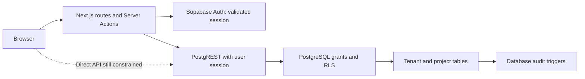

# Technical architecture

Next.js App Router is the presentation/server boundary. TypeScript strict mode and Zod validate project input. Server Components query through a per-request Supabase SSR client; Server Actions revalidate identity for each mutation. Supabase Auth owns credentials and sessions. PostgreSQL grants/RLS enforce access even when clients call the data API directly.

The existing reference is a separate Sites/Vinext/Cloudflare Worker application backed by D1 JSON storage and dispatch identity. It is not connected to this Supabase foundation. [Existing-site-review.md](existing-site-review.md) records the migration boundaries, role differences and regression baseline. Avoid copying dispatch-header trust into a standalone Next.js deployment; Supabase identity must be independently verified there.

Modules own validation, use cases and future queries. Routes compose modules rather than embedding financial/indicator logic. Shared code is limited to environment, identity and DB clients. Future modules may call explicit domain interfaces; circular imports and cross-module table writes require design review. A modular monolith is sufficient until measurable scaling or organizational needs justify services.

The current runtime uses only the public Supabase key and end-user session. No service-role client, public signup, upload endpoint or formula interpreter exists. Proxy refreshes cookies; protected routes/actions independently call getUser. Dynamic workspace responses and proxy cache-control prevent shared caching of session responses. Reverse proxies must honor private/no-store and must not cache Set-Cookie responses.

Application security includes generic authentication errors, input limits, SQL constraints, origin checks provided by Server Actions, response security headers and database auditing. Deployment needs TLS, Auth rate limiting, disabled signup, separate environments, and a reviewed MFA/SSO policy. CSP requires deployment-specific testing (Next.js scripts/nonces and Supabase origins); do not label the current headers a complete CSP. Sensitive beneficiaries/attachments are outside this stage.

Operational design: health endpoint reports process liveness only; authenticated smoke tests establish application readiness. CI checks types, tests, production build, local migrations/RLS and browser flows. Deploy to isolated staging and production projects. Logs must exclude passwords, tokens, source rows and workbook contents. Use platform logs for errors, Supabase Auth logs for authentication and database audit_events for mutations. Retention, alert thresholds, backup/PITR budget and RPO/RTO remain open acceptance decisions.

Official implementation references checked 2026-10-29:

- [Next.js Proxy](https://nextjs.org/docs/app/getting-started/proxy)
- [Next.js authentication guidance](https://nextjs.org/docs/app/guides/authentication)
- [Supabase SSR client and session verification](https://supabase.com/docs/guides/auth/server-side/creating-a-client)

The choice of getUser trades a network check for an up-to-date Auth user record. Authorization remains in live membership rows, not long-lived JWT role claims.
